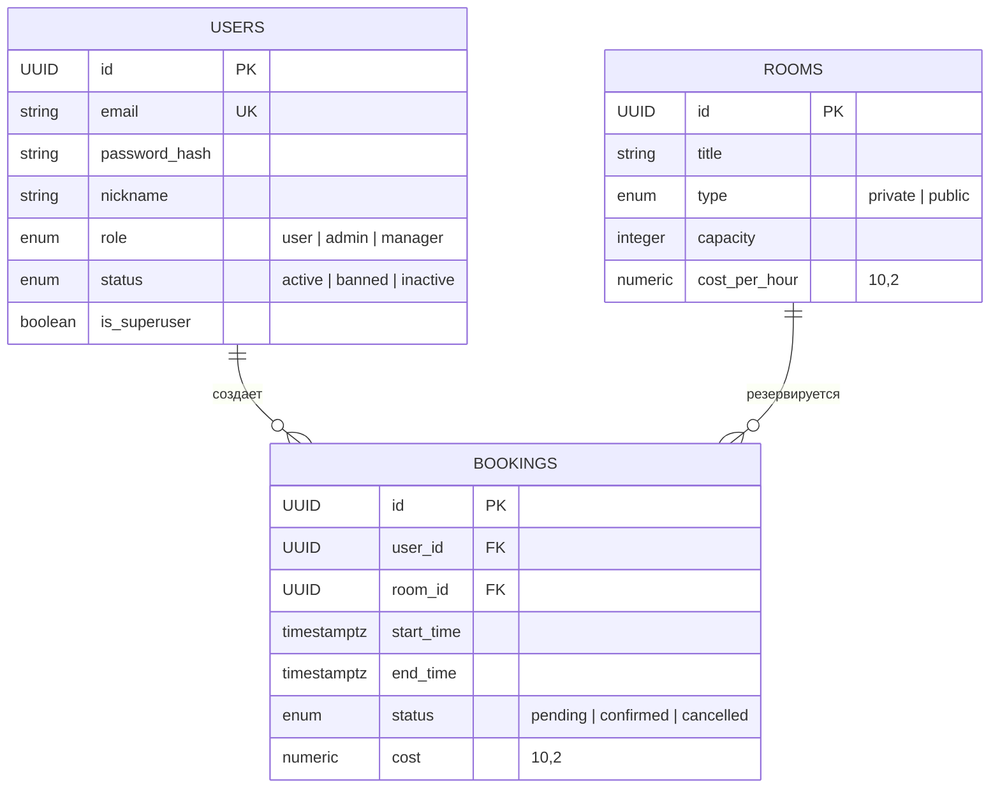

# FlexSpace

FlexSpace — API для коворкинга: пользователи просматривают помещения, создают и отменяют бронирования; менеджеры управляют помещениями, администраторы — учетными записями. Backend построен на FastAPI, PostgreSQL и SQLAlchemy; Redis используется для кэширования и хранения временных токенов.

## Содержание

- [Технологии](#технологии)
- [Структура проекта](#структура-проекта)
- [Запуск](#запуск)
- [Переменные окружения](#переменные-окружения)
- [База данных](#база-данных)
- [API](#api)
- [Схемы запросов и ответов](#схемы-запросов-и-ответов)
- [Тесты](#тесты)

## Технологии

- Python 3.14+
- FastAPI и Pydantic
- PostgreSQL 15, SQLAlchemy 2 и Alembic
- Redis
- SQLAdmin для административного интерфейса

## Структура проекта

```text
.
├── alembic/                     # Корневая конфигурация и миграции Alembic
│   └── versions/
├── backend/
│   ├── app/
│   │   ├── api/
│   │   │   ├── api_v1/          # Маршруты auth, users, rooms, manager, admin
│   │   │   └── depends.py       # Аутентификация и проверка ролей
│   │   ├── config/              # Настройки и JWT/хеширование паролей
│   │   ├── crud/                # Операции с пользователями и бронированиями
│   │   ├── database/            # Модели SQLAlchemy и сессии БД
│   │   ├── midlleware/          # Rate-limit middleware
│   │   ├── shemas/              # Pydantic-схемы API
│   │   ├── utils/               # Отправка писем и HTML-шаблоны
│   │   ├── admin.py             # Представления SQLAdmin
│   │   ├── main.py              # FastAPI-приложение
│   │   └── redis_client.py
│   ├── migrations/              # Отдельный каталог миграций backend
│   └── test/api_v1/             # API-тесты
├── frontend/
│   ├── index.html
│   ├── reset_password.html
│   └── templates/               # Шаблоны писем
├── Dockerfile
├── docker-compose.yml
├── pyproject.toml
└── requirements.txt
```

В репозитории есть два каталога миграций: `alembic/` в корне и `backend/migrations/`. В корневом `alembic.ini` настроен именно каталог `alembic/`.

## Запуск

### Docker Compose

Создайте в корне `.env` и задайте обязательные переменные из раздела [Переменные окружения](#переменные-окружения). Для запуска backend в Compose укажите адреса сервисов Compose:

```dotenv
POSTGRES_SERVER=db
POSTGRES_PORT=5432
REDIS_HOST=redis
REDIS_PORT=6379
```

Значение `POSTGRES_PASSWORD` должно совпадать с паролем, настроенным для PostgreSQL в `docker-compose.yml`. Не публикуйте `.env` и не добавляйте реальные пароли или JWT-секреты в репозиторий.

```powershell
docker compose up --build
```

API будет доступно на `http://localhost:8080`; интерактивная документация FastAPI — на `http://localhost:8080/docs`, интерфейс SQLAdmin — на `http://localhost:8080/admin`.

Схема БД не создается функцией запуска приложения: `init_db()` только добавляет начального администратора. Перед запуском backend база должна быть создана и приведена к схеме приложения миграциями. Важно: текущие миграции не полностью соответствуют моделям (см. [База данных](#база-данных)); проверьте и актуализируйте миграции до применения к новой базе.

### Локальный запуск

Установите зависимости из `requirements.txt` в Python 3.14+, запустите PostgreSQL и Redis, затем задайте `.env`. Для локального запуска обычно используются `POSTGRES_SERVER=127.0.0.1`, `POSTGRES_PORT=5433`, `REDIS_HOST=localhost`, `REDIS_PORT=6379`.

```powershell
python -m uvicorn backend.app.main:app --reload --host 0.0.0.0 --port 8080
```

## Переменные окружения

Настройки читаются из `.env` (пустые значения игнорируются). Обязательные:

| Переменная         | Назначение                                                    |
| ---------------------------- | ----------------------------------------------------------------------- |
| `JWT_SECRET_KEY`           | Секрет подписи токенов, не менее 32 байт |
| `POSTGRES_PASSWORD`        | Пароль PostgreSQL                                                 |
| `FIRST_SUPERUSER`          | Email начального администратора                 |
| `FIRST_SUPERUSER_PASSWORD` | Пароль начального администратора          |
| `FIRST_SUPERUSER_FULLNAME` | Имя/ник начального администратора         |

Основные переменные с настройками по умолчанию:

| Переменная            | По умолчанию                                               |
| ------------------------------- | --------------------------------------------------------------------- |
| `POSTGRES_SERVER`             | `127.0.0.1`                                                         |
| `POSTGRES_PORT`               | `5433`                                                              |
| `POSTGRES_USER`               | `postgres`                                                          |
| `POSTGRES_DB`                 | `FlexSpace`                                                         |
| `REDIS_HOST`                  | `localhost`                                                         |
| `REDIS_PORT`                  | `6379`                                                              |
| `JWT_ALGORITHM`               | `HS256`                                                             |
| `ACCESS_TOKEN_EXPIRE_MINUTES` | 60 минут                                                         |
| `REFRESH_TOKEN_EXPIRE_DAYS`   | 30 дней                                                           |
| `COOKIE_SECURE`               | `true`                                                              |
| `API_RATE_LIMIT`              | 120 запросов в минуту для `RateLimitMiddleware`  |

Для отправки писем настройте `SMTP_HOST`, `EMAILS_FROM_EMAIL` и, при необходимости, `SMTP_PORT`, `SMTP_TLS`, `SMTP_SSL`, `SMTP_USER`, `SMTP_PASSWORD`, `EMAILS_FROM_NAME`. Письма включаются, если заданы `SMTP_HOST` и `EMAILS_FROM_EMAIL`. `PUBLIC_BASE_URL` используется для ссылки восстановления пароля.

## База данных

Модели описаны в `backend/app/database/models.py`. Все первичные ключи — UUID, генерируемые приложением. Связь между пользователями и помещениями проходит через бронирования: у пользователя и помещения может быть несколько записей бронирования.



### Таблицы и ограничения

| Таблица | Поля и правила                                                                                                                                                                                                                                                                                                                                                                                                               |
| -------------- | ---------------------------------------------------------------------------------------------------------------------------------------------------------------------------------------------------------------------------------------------------------------------------------------------------------------------------------------------------------------------------------------------------------------------------------------- |
| `users`      | `id` — UUID PK; `email` — обязательный и уникальный; `password_hash`, `nickname` — обязательные; `role`: `user`, `admin`, `manager`; `status`: `active`, `banned`, `inactive`; `is_superuser` по умолчанию `false`. Индекс по `(status, role)`.                                                                                                   |
| `rooms`      | `id` — UUID PK; `title`; `type`: `private` или `public`; `capacity` > 0; `cost_per_hour` — `NUMERIC(10,2)` и неотрицательная сумма. Индекс по `(type, capacity, id)`.                                                                                                                                                                                                                |
| `bookings`   | `id` — UUID PK; `user_id` и `room_id` — внешние ключи на `users.id` и `rooms.id`; `start_time`, `end_time` — даты с часовым поясом; `status`: `pending`, `confirmed`, `cancelled`; `cost` — `NUMERIC(10,2)`. `end_time` должен быть позже `start_time`. Индексы по `(room_id, status, start_time, end_time)` и `(user_id, start_time)`. |

Бронирования в состояниях `pending` и `confirmed` занимают помещение. Стоимость рассчитывается при создании как почасовая ставка, умноженная на длительность; сумма округляется до двух знаков после запятой. Отменить через пользовательский API можно только бронирование `pending`.

### Миграции: важное замечание

Текущая модель является описанием ожидаемой схемы, но начальные миграции в `alembic/versions/` и `backend/migrations/versions/` отстают от нее. В частности, они не полностью отражают типы и ограничения стоимости, полный набор статусов бронирования, а также ограничения и индексы. Перед применением миграций к новой или существующей БД сравните их с `backend/app/database/models.py` и подготовьте корректную миграцию. При запуске приложения Alembic автоматически не вызывается.

## API

Все API-маршруты имеют префикс `/api/v1`. Если не указано иное, защищенные маршруты требуют access-токен в заголовке `Authorization: Bearer <access_token>`. Поля, помеченные как `Form`, передаются как form-urlencoded или multipart/form-data; тело бронирования передается в JSON.

### Аутентификация — `/auth`

| Метод и путь                  | Доступ                      | Запрос / результат                                                                                                                                                                                                                                             |
| --------------------------------------- | --------------------------------- | ----------------------------------------------------------------------------------------------------------------------------------------------------------------------------------------------------------------------------------------------------------------------------- |
| `POST /auth/registration`             | Публичный                | Форма: `email`, `nickname`, `password` (12–128 символов). Создает пользователя и возвращает access-токен; refresh-токен устанавливается в HttpOnly cookie. `201`.                               |
| `POST /auth/login`                    | Публичный                | Форма: `email`, `password`. Возвращает access-токен и устанавливает refresh-cookie.                                                                                                                                                     |
| `POST /auth/refresh`                  | Refresh-cookie                    | Обновляет пару токенов, ротируя refresh-токен.                                                                                                                                                                                                |
| `POST /auth/logout`                   | Refresh-cookie, если есть | Отзывает refresh-токен и удаляет cookie. `204`.                                                                                                                                                                                                        |
| `POST /auth/forgot_password`          | Публичный                | Форма: `email`. Возвращает одинаковый ответ вне зависимости от существования учетной записи; при включенной почте отправляет ссылку восстановления. |
| `GET /auth/reset_password`            | Публичный                | Возвращает HTML-страницу сброса пароля.                                                                                                                                                                                                         |
| `POST /auth/reset_password?token=...` | Публичный                | Форма: `password`, `password_confirm` (по 12–128 символов). Сбрасывает пароль и отзывает refresh-сессии.                                                                                                                   |

Ответ с токеном имеет вид:

```json
{
  "access_token": "<jwt>",
  "token_type": "bearer"
}
```

### Пользователь — `/users`

| Метод и путь | Доступ      | Запрос / результат                                                                                                                                                                                                                                      |
| ---------------------- | ----------------- | ---------------------------------------------------------------------------------------------------------------------------------------------------------------------------------------------------------------------------------------------------------------------- |
| `GET /users/me`      | Access-токен | Профиль пользователя с бронированиями.                                                                                                                                                                                               |
| `PATCH /users/me`    | Access-токен | Форма с полями `email` и `nickname`. **В текущем коде после обновления маршрут все равно возвращает `400 bad request`**; это поведение требует исправления. |
| `DELETE /users/me`   | Access-токен | Деактивирует учетную запись (status `inactive`), а не удаляет строку. `204`.                                                                                                                                              |

### Помещения и бронирования — `/rooms`

| Метод и путь                  | Доступ       | Запрос / результат                                                                                                                                                                                                                                                                                                                                                                                                                                 |
| --------------------------------------- | ------------------ | ----------------------------------------------------------------------------------------------------------------------------------------------------------------------------------------------------------------------------------------------------------------------------------------------------------------------------------------------------------------------------------------------------------------------------------------------------------------- |
| `GET /rooms/`                         | Публичный | Список помещений; query-параметры `page` (по умолчанию 1), `page_size` (10, диапазон 1–100), `filter_by_type` (`private`/`public`), `filter_by_capacity` (минимум 1), `start_time`, `end_time`. Для поиска доступности нужно передать обе границы timezone-aware интервала. Ответ кэшируется в Redis на 60 секунд. |
| `POST /rooms/booking/{room_id}`       | Access-токен  | JSON `{"start_time":"...","end_time":"..."}` с часовым поясом. Интервал не более 30 дней; создает бронирование со статусом `pending`. Ответ `201`.                                                                                                                                                                                                                                       |
| `GET /rooms/bookings/my`              | Access-токен  | Список бронирований текущего пользователя.                                                                                                                                                                                                                                                                                                                                                                                  |
| `DELETE /rooms/bookings/{booking_id}` | Access-токен  | Отменяет собственное бронирование в статусе `pending`. Успешный ответ `204`.                                                                                                                                                                                                                                                                                                                              |

Типовые ошибки создания бронирования: `404` — помещение не найдено; `409` — временной интервал уже занят; `422` — некорректный интервал или отсутствует часовой пояс.

### Управление помещениями — роль `manager`

| Метод и путь            | Доступ             | Запрос / результат                                                                             |
| --------------------------------- | ------------------------ | ------------------------------------------------------------------------------------------------------------- |
| `POST /manage_room/new_room`    | Manager или superuser | Форма: `title`, `type`, `capacity`, `cost_per_hour`. Создает помещение. `201`. |
| `DELETE /manage_room/{room_id}` | Manager или superuser | Удаляет помещение, если у него нет бронирований.                      |

### Администрирование пользователей — роль `admin`

| Метод и путь         | Доступ           | Запрос / результат                            |
| ------------------------------ | ---------------------- | ------------------------------------------------------------ |
| `POST /user/{user_id}/ban`   | Admin или superuser | Блокирует учетную запись.              |
| `POST /user/{user_id}/unban` | Admin или superuser | Активирует учетную запись.            |
| `POST /promote/{user_id}`    | Admin или superuser | Форма `role`: `user`, `manager` или `admin`. |

Ролевые маршруты принимают идентификаторы как `int`, в то время как модели используют UUID. Это несоответствие реализации; для реальных запросов и изменений ролей согласуйте тип параметров с UUID-первичными ключами.

## Схемы запросов и ответов

Pydantic-схемы расположены в `backend/app/shemas/` (название каталога в проекте именно `shemas`).

### Создание бронирования

```json
{
  "start_time": "2026-10-25T10:00:00+00:00",
  "end_time": "2026-10-25T11:00:00+00:00"
}
```

Обе даты должны включать часовой пояс; `end_time` должен быть позже `start_time`, длительность не может превышать 30 дней.

### Помещение

```json
{
  "title": "Переговорная",
  "type": "private",
  "capacity": 8,
  "cost_per_hour": "25.00"
}
```

`title` — 1–120 символов; `type` — `private` или `public`; `capacity` — от 1 до 500; `cost_per_hour` — неотрицательная сумма не более чем с двумя знаками после запятой.

### Бронирование в ответе

```json
{
  "id": "UUID",
  "room_id": "UUID",
  "start_time": "2026-10-25T10:00:00Z",
  "end_time": "2026-10-25T11:00:00Z",
  "status": "pending",
  "cost": "25.00"
}
```

## Тесты

API-тесты находятся в `backend/test/api_v1/test_api_flow.py`. Запуск из корня проекта:

```powershell
pytest backend/test/api_v1/test_api_flow.py
```

`pytest` не входит в runtime-зависимости `requirements.txt`; установите его в окружение разработки отдельно.
